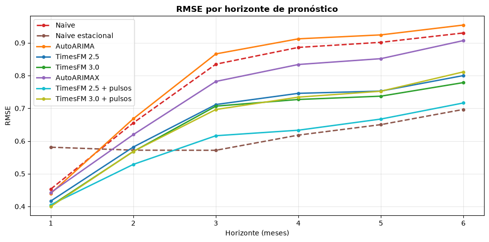
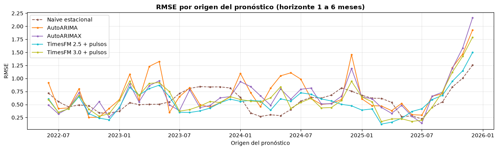

# TimesFM vs. AutoARIMA: series de tiempo e IA

En este proyecto muestro cómo funciona TimesFM, un modelo de IA para series de tiempo, y comparo su desempeño frente a métodos tradicionales como AutoARIMA.

Para medir el desempeño realicé un *rolling backtest*, pronosticando la tasa de desempleo de la Región de Valparaíso y comparando los resultados con y sin controles para el período de pandemia.

El objetivo de este proyecto es comparar los modelos TimesFM 2.5 y 3.0 frente a métodos tradicionales. Para ello opté por AutoARIMA, que permite realizar múltiples comparaciones de forma automática, aunque existen otros enfoques econométricos más sofisticados que podrían evaluarse en futuros trabajos.

## Principales resultados

Al realizar la comparación, **TimesFM 2.5 logró superar a AutoARIMA en varios horizontes de pronóstico**. Sin embargo, no logró superar de forma consistente al modelo naive estacional, que simplemente repite el valor observado en el mismo mes del año anterior.

Además, TimesFM 3.0, pese a ser la versión más reciente, no mostró ventajas consistentes frente a TimesFM 2.5.



*Comparación del RMSE por horizonte de pronóstico. Un menor RMSE representa un menor error.*

Otro punto importante a destacar es que ninguno de los modelos logró anticipar adecuadamente el aumento sostenido del desempleo durante 2026. Esto se aprecia mejor al observar la evolución del RMSE por origen de pronóstico.



De todas formas, TimesFM 2.5 demostró ser una alternativa competitiva frente a AutoARIMA, aunque los resultados también muestran la importancia de comparar modelos complejos con métodos sencillos.

## Metodología

La comparación consistió en un *rolling backtest*. Pronostiqué horizontes de uno a seis meses para el desempleo de la Región de Valparaíso, utilizando **43 orígenes mensuales desde junio de 2022 hasta diciembre de 2025**. Elegí este período para evitar realizar pronósticos desde meses de pandemia, aunque los modelos sí utilizan esa información histórica.

Como fuente de datos reconstruí la tasa de desempleo a partir de los microdatos de la Encuesta Nacional de Empleo (ENE) del Instituto Nacional de Estadísticas de Chile (INE).

Para realizar la comparación agrupé los modelos en dos categorías: modelos univariados y modelos con variables de intervención. Como intervención utilicé 19 pulsos mensuales correspondientes al período de pandemia, entre marzo de 2020 y septiembre de 2021. Fuera de ese período, las variables de intervención toman el valor cero.

### Modelos evaluados

**Modelos univariados:**

- Naive: repite el último valor observado.
- Naive estacional: repite el valor del mismo mes del año anterior.
- AutoARIMA.
- TimesFM 2.5.
- TimesFM 3.0.

**Modelos con intervención:**

- AutoARIMAX: AutoARIMA con pulsos mensuales de pandemia.
- TimesFM 2.5 + pulsos (XReg): intervención externa sobre la serie utilizando los mismos pulsos.
- TimesFM 3.0 + pulsos: incorporación de las mismas variables mediante covariables nativas.

Para evaluar el desempeño utilicé el RMSE, el sesgo y el test estadístico de Diebold-Mariano, incluyendo la corrección de Harvey, Leybourne y Newbold.

## Estructura del repositorio

El repositorio contiene los cuadernos de Python, los datos utilizados, las funciones auxiliares y los resultados de los pronósticos.

| Archivo | Descripción |
|---|---|
| `00_crea_tabla_desempleo.ipynb` | Construcción de la serie de desempleo a partir de los microdatos de la ENE. |
| `01_pronostico_desempleo.ipynb` | Cuaderno principal con la estimación de modelos, el backtest, las comparaciones y las conclusiones. |
| `funciones_pronostico.py` | Funciones utilizadas para preparar los datos, ejecutar los modelos y generar los gráficos. |
| `serie_desempleo_regional.csv` | Serie de desempleo utilizada en el backtest principal. |
| `serie_desempleo_regional_actualizado.csv` | Datos actualizados para las evaluaciones posteriores. |
| `requirements.txt` | Librerías de Python necesarias para ejecutar el proyecto. |
| `resultados/` | Archivos CSV con los pronósticos generados por cada modelo y las proyecciones posteriores. |

## Instalación y ejecución

El proyecto fue desarrollado y probado con **Python 3.12**, utilizando un computador de gama media sin GPU.

Para descargar el repositorio:

```bash
git clone https://github.com/arturodiazsalgado/timesfm-vs-autoarima-desempleo-chile.git

cd timesfm-vs-autoarima-desempleo-chile
```

Crear un entorno virtual e instalar las dependencias:

```bash
python3.12 -m venv .venv

source .venv/bin/activate

python -m pip install -r requirements.txt
```

Para abrir el cuaderno en Jupyter Notebook:

```bash
python -m pip install notebook

jupyter notebook 01_pronostico_desempleo.ipynb
```

El cuaderno `01_pronostico_desempleo.ipynb` es el archivo principal del proyecto. Utiliza la serie de desempleo incluida en el repositorio y permite ejecutar los modelos y revisar sus resultados.

El cuaderno `00_crea_tabla_desempleo.ipynb` contiene el procedimiento para construir la serie a partir de los microdatos originales de la ENE.

La primera vez que se ejecuta TimesFM, sus pesos deben descargarse desde Hugging Face, por lo que se requiere conexión a internet. TimesFM 3.0 puede solicitar la aceptación de su licencia y la autenticación en Hugging Face.

Los resultados de los modelos también están guardados en la carpeta `resultados/`, por lo que pueden revisarse sin necesidad de volver a ejecutar todas las estimaciones.

## Limitaciones y posibles aplicaciones

La principal limitación de este proyecto es que desconozco el detalle completo de los datos utilizados para entrenar TimesFM, por lo que no puedo descartar que parte de la información del backtest histórico estuviera incluida en su entrenamiento.

Para reducir este riesgo, en el punto **4.3 del cuaderno `01_pronostico_desempleo.ipynb`** reviso por separado 39 pares de origen y horizonte, correspondientes a nueve meses objetivo posteriores a septiembre de 2025. Esto permite evaluar TimesFM 2.5 con información que todavía no estaba publicada cuando se actualizaron sus pesos, el 1 de octubre de 2025.

Otra limitación es que el análisis se concentra en el desempleo de una sola región. Los resultados podrían cambiar al utilizar otras series de tiempo o al incorporar variables adicionales.

De todas formas, **TimesFM 2.5 representa una alternativa viable y económica para implementar pronósticos dentro de una empresa**. Sus pesos tienen licencia Apache 2.0, que permite el uso comercial sin costos de licencia por el modelo, y puede ejecutarse localmente en un computador de gama media, sin necesidad de GPU.

En cambio, los pesos descargables de TimesFM 3.0 tienen una licencia que restringe su uso comercial y productivo. Su utilización comercial mediante servicios autorizados de Google Cloud está sujeta a condiciones distintas.

En el mundo de riesgo de crédito, estos modelos pueden ser especialmente útiles para seguimiento de cartera, MIS y control de gestión. También pueden utilizarse como modelos complementarios para comparar el desempeño de metodologías ya implementadas.

Como posible extensión del trabajo, me interesa evaluar si la incorporación de variables macroeconómicas, como el IMACEC o la inflación, permite anticipar mejor cambios importantes en el desempleo.

## Referencias y enlaces

- [Google Research — TimesFM](https://github.com/google-research/timesfm). Repositorio oficial del proyecto.
- [TimesFM 2.5 — Hugging Face](https://huggingface.co/google/timesfm-2.5-200m-pytorch). Modelo y licencia.
- [TimesFM 3.0 — Hugging Face](https://huggingface.co/google/timesfm-3.0-pytorch). Modelo y condiciones de uso.
- [Das et al. (2024) — A decoder-only foundation model for time-series forecasting](https://proceedings.mlr.press/v235/das24c.html).
- [Nixtla — StatsForecast](https://github.com/Nixtla/statsforecast). Librería utilizada para AutoARIMA.
- [Instituto Nacional de Estadísticas — Encuesta Nacional de Empleo](https://www.ine.gob.cl/estadisticas/sociales/mercado-laboral/ocupacion-y-desocupacion). Fuente de los datos.
- [INE — Documento metodológico de la ENE](https://www.ine.gob.cl/docs/default-source/ocupacion-y-desocupacion/metodologia/espanol/metodologia-ene-2020.pdf).
- Diebold, F. X. y Mariano, R. S. (1995). *Comparing Predictive Accuracy*. Journal of Business & Economic Statistics, 13(3), 253–263.
- Harvey, D., Leybourne, S. y Newbold, P. (1997). *Testing the Equality of Prediction Mean Squared Errors*. International Journal of Forecasting, 13(2), 281–291.

---

## Autor

**Arturo Díaz Salgado**  
Ingeniero Civil Industrial · Magíster en Economía Financiera

- **LinkedIn:** https://www.linkedin.com/in/arturodiazsalgado/
- **Portafolio personal:** https://arturodiazsalgado.cl/
- **GitHub:** https://github.com/arturodiazsalgado